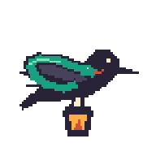

<a href="https://corvus.gent/logo">
  <picture>
    <source media="(prefers-color-scheme: dark)" srcset="assets/corvus-flight-dark.gif">
    <source media="(prefers-color-scheme: light)" srcset="assets/corvus-flight-light.gif">
    
  </picture>
</a>

<h1>Hey, I'm Gabriel 👋</h1>

CEO &amp; General at Corvus. One-man army building the coolest community in the world from San Francisco.

<em>🪔 I am looking for a human. — Diogenes</em>

[Website](https://corvus.gent) · [LinkedIn](https://www.linkedin.com/in/francisco-gabriel-van-langenhove) · [X](https://x.com/gabe_maxxing) · [Email](mailto:gabriel@corvus.gent)

## What I’m building

**[Corvus](https://corvus.gent)** · A community for people who like building things together. Play the [games](https://corvus.gent/games/), explore the [community music ranking](https://corvus.gent/music/), or [join the Legion](https://corvus.gent/legion/).

### Corvus development activity

Git activity on Corvus’s main branch, including contributions. Snapshot from **19 Nov 2026 at 20:19 Brussels time**. The last day in each row is partial.

| Period | Commits | Lines added | Lines removed |
| --- | ---: | ---: | ---: |
| 19 Nov 2026 | 12 | 1,378 | 103 |
| 7 days ending 19 Nov 2026 | 108 | 97,795 | 3,887 |
| 30 days ending 19 Nov 2026 | 243 | 128,954 | 7,725 |

[Daily chart](https://corvus.gent/built#shipping) · [Weekly chart](https://corvus.gent/built?period=week#shipping) · [Monthly chart](https://corvus.gent/built?period=month#shipping)

## Open source

Pick a project below to try or contribute to. For a bigger idea, open an issue first. In a pull request, tell me what changed, why it matters, and how you tested it.

| Project | What it does | Try or contribute |
| --- | --- | --- |
|  [stayawake](https://github.com/Gabriellvl/stayawake) | A command-line switch that keeps your Mac awake during long jobs. | [Install](https://github.com/Gabriellvl/stayawake/releases/latest) · [Contribute](https://github.com/Gabriellvl/stayawake/blob/main/CONTRIBUTING.md) |
| [nightjar-mcp](https://github.com/Gabriellvl/nightjar-mcp) | A small MCP server you can host yourself. | [Contribute](https://github.com/Gabriellvl/nightjar-mcp/blob/main/CONTRIBUTING.md) |
| [FlowSOM](https://github.com/Gabriellvl/FlowSOM) | Python and Numba benchmarks for clustering flow cytometry data. | [Contribute](https://github.com/Gabriellvl/FlowSOM/blob/main/CONTRIBUTING.md) |

[More projects open for contributions](https://github.com/search?q=user%3AGabriellvl+topic%3Aopen-for-contributions+archived%3Afalse&type=repositories) · [All repositories](https://github.com/Gabriellvl?tab=repositories)

## Stack

[Claude](https://claude.ai/) · [Codex](https://openai.com/codex/) · [Grok](https://grok.com/) · [Vercel](https://vercel.com/) · [Redis](https://redis.io/)

## Other projects

| Project | What it does |
| --- | --- |
| PartyCrasher 3000 · [CV](https://corvus.gent/cv) | I taught our UGent team’s TurtleBot to dance salsa. It could drive itself, talk, play music, serve beer and fire M&M’s from a candy cannon. |
| [Dwengo-1](https://github.com/SELab-2/Dwengo-1) | Our SELab-2 team built a platform where teachers assign learning paths and follow student progress. |
| [oxyvitale-402](https://github.com/Corvus-gent/oxyvitale-402) | A four-language payment status page for the Oxy-Vitale client site. |
