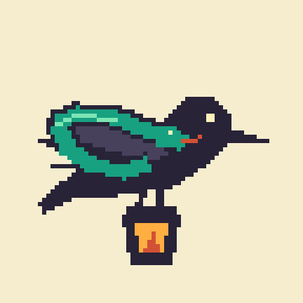

<h1 align="center">Hey, I'm Gabriel 👋</h1>

CEO &amp; General at Corvus. One-man army building the coolest community in the world from San Francisco.

<em>🪔 I am looking for a human. — Diogenes</em>

[Website](https://corvus.gent) · [LinkedIn](https://www.linkedin.com/in/francisco-gabriel-van-langenhove) · [X](https://x.com/gabe_maxxing) · [Email](mailto:gabriel@corvus.gent)

## 🛠️ Build with me

**[Find projects open for contributions →](https://github.com/search?q=user%3AGabriellvl+topic%3Aopen-for-contributions+archived%3Afalse&type=repositories)**

Pick a project, open an issue for a bigger idea or fork it and send a focused pull request. Tell me what you changed, why it matters and how you tested it. I review PRs after the automated checks and either merge them or ask for changes.

## 📈 What shipped today?

[Today](https://corvus.gent/built) · [Yesterday](https://corvus.gent/built?ago=1) · [Two days ago](https://corvus.gent/built?ago=2) · [Browse the full history →](https://corvus.gent/built#shipping)

## 🐦‍⬛ Currently building

-  **[Corvus](https://corvus.gent)** · Daily games, a community music ranking and public stats. [Follow the code](https://github.com/Corvus-gent/loading-website/commits/main/).
-  **[stayawake](https://github.com/Gabriellvl/stayawake)** · A small macOS command-line switch for sleep. [Releases](https://github.com/Gabriellvl/stayawake/releases) · [Pull requests](https://github.com/Gabriellvl/stayawake/pulls)
- **[nightjar-mcp](https://github.com/Gabriellvl/nightjar-mcp)** · A small, hostable MCP server for Corvus. [Activity](https://github.com/Gabriellvl/nightjar-mcp/activity) · [Pull requests](https://github.com/Gabriellvl/nightjar-mcp/pulls)

## Open source

| Project | What it does | Follow or contribute |
| --- | --- | --- |
| [stayawake](https://github.com/Gabriellvl/stayawake) | macOS CLI and packaging. | [Guide](https://github.com/Gabriellvl/stayawake/blob/main/CONTRIBUTING.md) · [Issues](https://github.com/Gabriellvl/stayawake/issues) |
| [nightjar-mcp](https://github.com/Gabriellvl/nightjar-mcp) | MCP over Streamable HTTP. | [Guide](https://github.com/Gabriellvl/nightjar-mcp/blob/main/CONTRIBUTING.md) · [Issues](https://github.com/Gabriellvl/nightjar-mcp/issues) |
| [FlowSOM](https://github.com/Gabriellvl/FlowSOM) | Python and Numba benchmarks for clustering flow cytometry data. | [Guide](https://github.com/Gabriellvl/FlowSOM/blob/main/CONTRIBUTING.md) · [Issues](https://github.com/Gabriellvl/FlowSOM/issues) |

[Recent GitHub activity](https://github.com/Gabriellvl?tab=overview#user-activity-overview) · [All repositories](https://github.com/Gabriellvl?tab=repositories)

## Stack

[Claude](https://claude.ai/) · [Codex](https://openai.com/codex/) · [Grok](https://grok.com/) · [Vercel](https://vercel.com/) · [Redis](https://redis.io/)

## Other projects

| Project | What it does |
| --- | --- |
| PartyCrasher 3000 · [CV](https://corvus.gent/cv) | I taught our UGent team’s TurtleBot to dance salsa. It could drive itself, talk, play music, serve beer and fire M&M’s from a candy cannon. |
| [Dwengo-1](https://github.com/SELab-2/Dwengo-1) | Our SELab-2 team built a platform where teachers assign learning paths and follow student progress. |
| [oxyvitale-402](https://github.com/Corvus-gent/oxyvitale-402) | A four-language payment status page for the Oxy-Vitale client site. |
