<h1 align="center">Hey, I'm Gabriel 👋</h1>

Go-to-Market Engineer at Pidgy (<a href="https://pidgy-ai.com">pidgy-ai.com</a>). CS background, sales brain. I build things and get them in front of people.

<em>🪔 I am looking for a human. — Diogenes</em>

  
  
  
  

## Right now

- Growing Pidgy, an AI email assistant.
- 🐦‍⬛ Building daily games and public stats on [corvus.gent](https://corvus.gent).
- 🪔 Upcoming business philosophist. In San Francisco for hackathons and founder meetups, November 6–15, 2026. [Let’s meet](https://corvus.gent/sf).
- Learning Chinese and training Brazilian jiu-jitsu.

## Stack

Vercel · Redis (Claude, Codex, Astra, Grok Bot)

## Featured

| Project | What it does |
| --- | --- |
| [loading-website](https://github.com/Corvus-gent/loading-website) | The code behind [corvus.gent](https://corvus.gent), from daily games to a public uptime monitor. |
| [Dwengo-1](https://github.com/SELab-2/Dwengo-1) | Our SELab-2 team built a platform where teachers assign learning paths and follow student progress. |
| [FlowSOM](https://github.com/Gabriellvl/FlowSOM) | Benchmarks for clustering flow cytometry data with the Python FlowSOM implementation. |
| [oxyvitale-402](https://github.com/Corvus-gent/oxyvitale-402) | A four-language payment status page for the Oxy-Vitale client site. |

<picture>
  <source media="(prefers-color-scheme: dark)" srcset="https://raw.githubusercontent.com/Gabriellvl/Gabriellvl/output/github-snake-dark.svg">
  <source media="(prefers-color-scheme: light)" srcset="https://raw.githubusercontent.com/Gabriellvl/Gabriellvl/output/github-snake.svg">
  
</picture>
