<h1 align="center">Hey, I'm Gabriel 👋</h1>

CEO &amp; General at Corvus. One-man army building the coolest community in the world from San Francisco.

<em>🪔 I am looking for a human. — Diogenes</em>

  
  
  
  

## 🛠️ Build with me

**[Find projects open for contributions →](https://github.com/search?q=user%3AGabriellvl+topic%3Aopen-for-contributions+archived%3Afalse&type=repositories)**

Pick a project, open an issue for a bigger idea or fork it and send a focused pull request. Tell me what you changed, why it matters and how you tested it. I review PRs after the automated checks and either merge them or ask for changes.

## 🐦‍⬛ Currently building

- **[Corvus](https://corvus.gent)** · Daily games, a community music ranking and public stats. [Follow the code](https://github.com/Corvus-gent/loading-website/commits/main/).
- **[stayawake](https://github.com/Gabriellvl/stayawake)** · A small macOS command-line switch for sleep. [Releases](https://github.com/Gabriellvl/stayawake/releases) · [Pull requests](https://github.com/Gabriellvl/stayawake/pulls)
- **[nightjar-mcp](https://github.com/Gabriellvl/nightjar-mcp)** · A small, hostable MCP server for Corvus. [Activity](https://github.com/Gabriellvl/nightjar-mcp/activity) · [Pull requests](https://github.com/Gabriellvl/nightjar-mcp/pulls)

## Open source

| Project | What it does | Follow or contribute |
| --- | --- | --- |
| [stayawake](https://github.com/Gabriellvl/stayawake) | macOS CLI and packaging. | [Guide](https://github.com/Gabriellvl/stayawake/blob/main/CONTRIBUTING.md) · [Issues](https://github.com/Gabriellvl/stayawake/issues) |
| [nightjar-mcp](https://github.com/Gabriellvl/nightjar-mcp) | MCP over Streamable HTTP. | [Guide](https://github.com/Gabriellvl/nightjar-mcp/blob/main/CONTRIBUTING.md) · [Issues](https://github.com/Gabriellvl/nightjar-mcp/issues) |
| [FlowSOM](https://github.com/Gabriellvl/FlowSOM) | Python and Numba benchmarks for clustering flow cytometry data. | [Guide](https://github.com/Gabriellvl/FlowSOM/blob/main/CONTRIBUTING.md) · [Issues](https://github.com/Gabriellvl/FlowSOM/issues) |

[Recent GitHub activity](https://github.com/Gabriellvl?tab=overview#user-activity-overview) · [All repositories](https://github.com/Gabriellvl?tab=repositories)

## Stack

  &emsp;<a href="https://openai.com/codex/"><picture><source media="(prefers-color-scheme: dark)" srcset="assets/logos/codex-dark.svg"><source media="(prefers-color-scheme: light)" srcset="assets/logos/codex.svg"></picture></a>&emsp;<a href="https://grok.com/"><picture><source media="(prefers-color-scheme: dark)" srcset="assets/logos/grok-dark.svg"><source media="(prefers-color-scheme: light)" srcset="assets/logos/grok.svg"></picture></a>&emsp;&emsp;

## Other projects

| Project | What it does |
| --- | --- |
| PartyCrasher 3000 · [CV](https://corvus.gent/cv) | I taught our UGent team’s TurtleBot to dance salsa. It could drive itself, talk, play music, serve beer and fire M&M’s from a candy cannon. |
| [Dwengo-1](https://github.com/SELab-2/Dwengo-1) | Our SELab-2 team built a platform where teachers assign learning paths and follow student progress. |
| [oxyvitale-402](https://github.com/Corvus-gent/oxyvitale-402) | A four-language payment status page for the Oxy-Vitale client site. |

<picture>
  <source media="(prefers-color-scheme: dark)" srcset="https://raw.githubusercontent.com/Gabriellvl/Gabriellvl/output/github-snake-dark.svg">
  <source media="(prefers-color-scheme: light)" srcset="https://raw.githubusercontent.com/Gabriellvl/Gabriellvl/output/github-snake.svg">
  
</picture>
